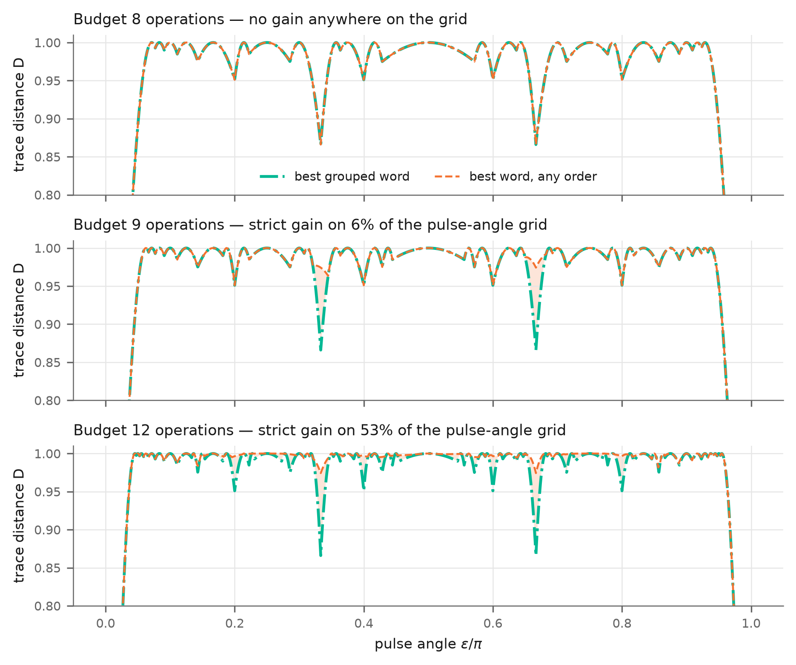
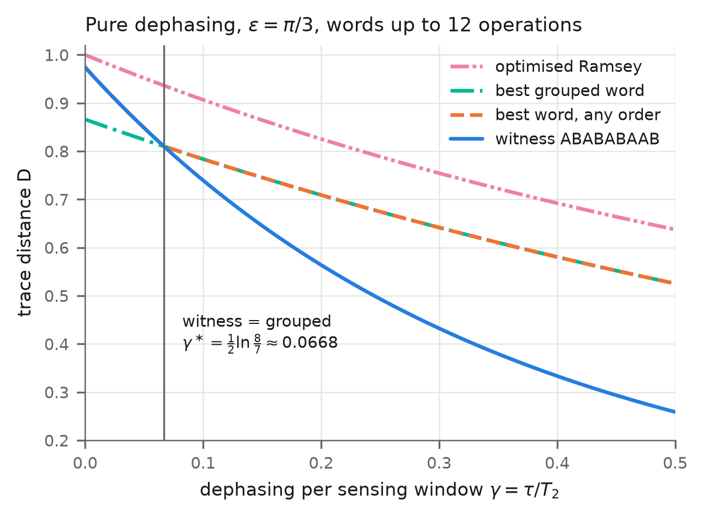
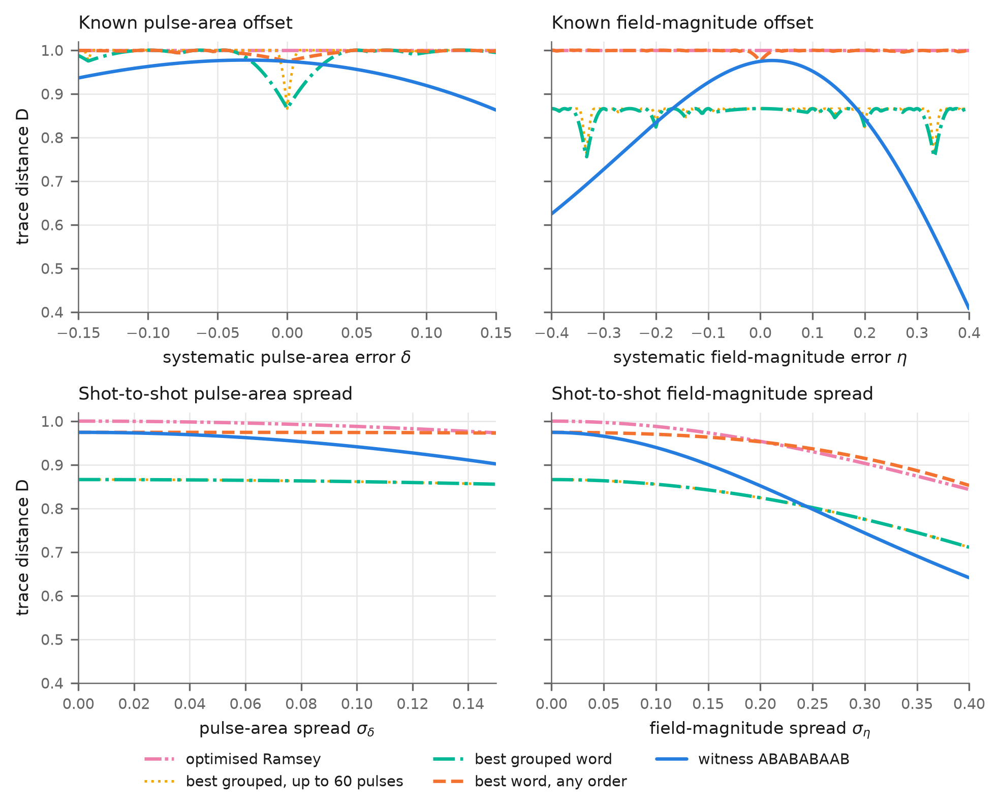
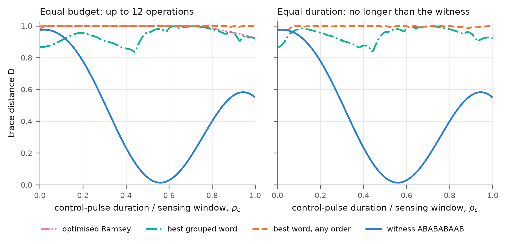
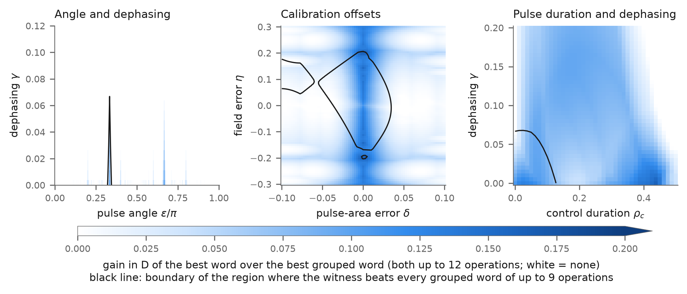
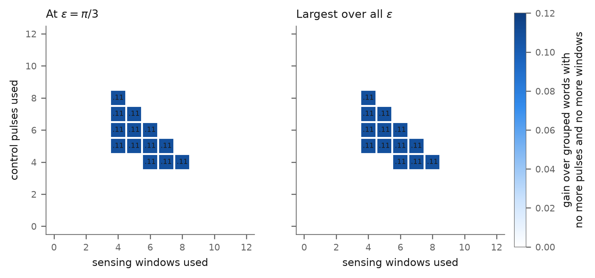

# Independent replication: density matrices, channels and noise

Branch `research/independent-density-matrix-replication`, based on `b39b6fa`.
Scope: an independent attempt to falsify the restricted single-qubit
sign-discrimination result, and to map where it stops holding once noise is added.

**Status of the evidence.** Statements marked *exact* come from symbolic or
rational arithmetic (`holonomy_dm/exact.py`). Everything else is floating-point
numerics on finite grids and finite word depth: evidence, not proof. Nothing
here is an experiment, and nothing here supports a general quantum-metrological
advantage. A free-pulse Ramsey protocol beats every fixed-alphabet word in
the ideal model and under dephasing.

## Verdict in brief

| Claim in the repository | Independent result |
|---|---|
| Nine-step witness `ABABABAAB` at ε = π/3 has D² = 243/256 | Confirmed, *exact* (explicit density matrices) |
| No strict advantage for any ε at budgets L ≤ 8; one exists at L = 9 | Confirmed, *exact*, by a different decision procedure |
| Every grouped word of any length has D² ≤ 3/4 at ε = π/3 | Confirmed, *exact*, but only at exactly ε = π/3 (see L1) |
| Tilted-axis cases 27/32 vs 3/8 and 249/256 vs 3/4 | Confirmed numerically to 1e-13 |
| σ_y readout is Helstrom-optimal | Confirmed; also holds in every noise model used here |
| Certificate prints the README's two `PASS` lines | Confirmed; actual log and runtime below |

No numerical discrepancy was found between the two implementations
(worst deviation 4e-14 over the words compared). The discrepancies that do
exist are in counting conventions and in how far the claims extend; they are
listed under "Discrepancies" and none was repaired.

## What was built

```
replication/
  holonomy_dm/channels.py     2x2 unitaries, Kraus channels, Lindblad pulse, CPTP checks
  holonomy_dm/protocols.py    words, grouped words, Ramsey comparators, noise ensembles
  holonomy_dm/enumeration.py  exhaustive, unpruned enumeration of all words to depth 12
  holonomy_dm/exact.py        exact witness, exact ceiling, exact universal search
  holonomy_dm/sweeps.py       noise sweeps, comparators, thresholds
  run_all.py  make_figures.py results/  figures/  tests/
```

The implementation shares no code with `epistemic_holonomy_certificate.py`.
States are explicit density matrices; every operation is a Kraus channel
ρ → Σ K ρ K†; distances are trace distances of the output pair. The original
module is imported only inside tests, as the thing being checked.

Conventions: |0⟩⟨0| is the +Z state, R_n(θ) = exp(−iθ n·σ/2), A = R_y(ε),
B_h = R_z(hπ/2), words are chronological.

## Rerun of the existing symbolic certificate

Unmodified script, Python 3.13.18, SymPy 1.13.3, 2 vCPU Xeon 2.1 GHz.
Exit code 0, empty stderr, identical output on every run.
Wall time 3.8 / 4.2 / 4.4 s on an idle machine (first cold run 5.6 s).

```
2 1 []
3 2 []
4 4 []
5 6 []
6 12 []
7 20 []
8 34 []
9 56 ['AABABABAB', 'ABABAABAB', 'ABABABAAB']
BAB 27/32 grouped ceiling squared 3/8
ABAB 249/256 grouped ceiling squared 3/4
PASS: nine-step witness D^2=243/256; unlimited grouped ceiling D^2=3/4
PASS: all certificate assertions completed
```

Recorded in `results/certificate_run.json` and `results/certificate_stdout.txt`;
CI diffs each run against the latter.

## Exact results

1. **Witness.** With exact SymPy matrices at ε = π/3,
   ρ± = [[15/32, √3/16 ∓ 9√3 i/32], [√3/16 ± 9√3 i/32, 17/32]],
   ρ₊ − ρ₋ = (9√3/16) σ_y, eigenvalues ±9√3/16, D² = 243/256.
2. **Unlimited grouped ceiling.** U_A⁶ = −1 and U_B⁴ = −1 at ε = π/3, so every
   grouped word reduces to one of 6 × 4 × 2 cases; the maximum is D² = 3/4 (`AB`).
3. **Universal search.** D² for each word is computed as −det(ρ₊ − ρ₋) over
   Q(i)[cos ε/2, sin ε/2], reduced to Q[cos ε], and compared with every grouped
   word within the same budget. Feasibility of the strict inequalities is
   decided by factoring into irreducibles, Sturm root counting with bisection,
   and exact rational sign evaluation (the original uses simultaneous root
   isolation). All 2^L words are enumerated, with no symmetry reduction.

   | L | words | distinct D² | words with a strict advantage at some ε |
   |---|---|---|---|
   | 0–8 | 511 total | up to 35 | 0 |
   | 9 | 512 | 59 | 3 |
   | 10 | 1024 | 102 | 14 |
   | 11 | 2048 | 179 | 48 |
   | 12 | 4096 | 316 | 144 |

   Depth 9 takes 40 s; depth 12 took 1237 s (`results/exact_universal_search_depth12.json`).
   Depths 10–12 are new; the original certificate stops at 9.
4. **Witness under dephasing.** With coherence factor λ = e^(−γ) per sensing
   window, D_witness = (√3/16) λ (1 + 8λ²) and D_AB = (√3/2) λ, *exact*.
   They cross at λ² = 7/8, i.e. **γ\* = ½ ln(8/7) ≈ 0.0668**.

## Numerical results, ideal model (depth 12, 8191 words, 3601 pulse angles)

- Budgets 1–8: largest |best word − best grouped| on the grid is 1e-15.
- Budget 9: gain on 5.7% of the angle grid, in two windows
  ε/π ∈ [0.321, 0.345] and [0.650, 0.683]; maximum 0.1083 at ε = π/3.
- Budgets 10, 11, 12: gain on 27%, 36%, 53% of the grid. The maximum gain
  stays 0.1083 at ε = π/3; no word of up to 12 operations exceeds
  D = 9√3/16 there (61 words attain it, 66 beat the grouped ceiling).
- **Equal counts of control and sensing operations.** A grouped word with the
  witness's exact counts (5 pulses, 4 windows) is `AAAAABBBB`, which has D = 0
  because four quarter-turns are the identity up to sign. Any even number of
  windows gives D = 0 for a grouped word, so "same counts" comparisons are
  degenerate. The fair version (grouped words with no more pulses and no more
  windows) gives the same 0.1083 gain at (5,4), and no gain for any count pair
  with total ≤ 8. Full table: `results/equal_counts.csv`, Fig. 6.



## Noise models

All maps are CPTP; tests check trace preservation and Choi positivity.

| Parameter | Meaning | Implementation |
|---|---|---|
| γ | dephasing per sensing window (τ/T₂) | phase-flip Kraus pair after R_z; equals the Lindblad solution |
| δ | fractional pulse-area error | A = R_y(ε(1+δ)) |
| η | fractional field-magnitude error | sensing angle h(π/2)(1+η) |
| ρ_c | pulse duration / sensing window | drive, field and dephasing act together during the pulse: exp(Liouvillian) → Choi → Kraus |
| σ_δ, σ_η | shot-to-shot Gaussian spread of δ, η | states averaged over 201 Gauss–Hermite nodes |

Comparators: the fixed witness; the best word of any order (≤ 9, ≤ 12);
the best grouped word (≤ 9, ≤ 12); grouped words up to 60 pulses and 24
windows; and a Ramsey protocol with one free-area pulse and one free-duration
window, optimised with full knowledge of the noise.

## Where interleaving keeps or loses its advantage (nominal ε = π/3)

| Noise axis | Witness beats every grouped word ≤ 9 while | Any word ≤ 12 beats grouped ≤ 12 | Against optimised Ramsey |
|---|---|---|---|
| Dephasing γ | γ < 0.0668 (*exact*: ½ ln 8/7) | γ ≤ 0.065 (grid step 0.0025) | Ramsey ahead or equal |
| Known pulse error δ | −3.69% < δ < +3.44% | −3.5% … +4.1% around nominal; 53% of ±15% | Ramsey ahead or equal |
| Known field error η | −16.8% < η < +20.6% | everywhere in ±40% | Ramsey ahead or equal |
| Pulse duration ρ_c | ρ_c < 0.127 | everywhere in [0, 1] | best word ahead for ρ_c ≥ 0.685 |
| Pulse spread σ_δ | whole range tested (≤ 0.15) | whole range | Ramsey ahead or equal |
| Field spread σ_η | σ_η < 0.244 | whole range (≤ 0.40) | best word ahead for σ_η ≥ 0.21 |

Reading the table:

- **Dephasing is what removes the advantage.** At ε = π/3 no word of up to 12
  operations beats `AB` once γ exceeds about 0.067. Over the whole
  (ε, γ) map with γ ≤ 0.3, a gain exists on 0.6% (budget 9) and 1.9%
  (budget 12) of grid points, and at no grid point with γ ≥ 0.0675 (grid step 0.0075).
- **The specific witness is fragile; interleaving as a class is not.** Under
  field offsets, field spread and finite pulse duration, some interleaved word
  still beats every grouped word of the same budget across the ranges tested,
  but it is a different word at each point and is chosen with knowledge of
  the noise.
- **Finite pulse duration.** The witness falls below grouped words once pulses
  last more than 13% of a sensing window, and to D < 0.05 near ρ_c = 0.55.
  With the field acting during pulses, pulse-only words carry signal.
- **Two regions where a fixed-alphabet word beats this Ramsey family** (large
  field spread, long pulses). The Ramsey family here is one pulse and one
  window; these are regions where that family is a weak baseline, not evidence
  of an advantage over optimised control.







## Discrepancies and their mathematical origin

None of these was repaired; the original script and README are unchanged
apart from one pointer line.

- **D1. Unique-polynomial counts differ (56 vs 59 at depth 9; 34 vs 35 at 8).**
  The certificate deduplicates the *signed* Bloch component y over words of
  the form A…B; this implementation deduplicates D² over all words. Of the 56
  signed polynomials only 45 have distinct squares (11 pairs differ by sign
  only, so the certificate tests 11 redundant cases). The other 14 of the 59
  come from words beginning with B or ending with A, which equal shorter
  words. Verdicts are unaffected.
- **D2. Two of the three depth-9 words printed by the certificate are not
  witnesses at ε = π/3.** There, `AABABABAB` has D = 0.758 and `ABABAABAB` has
  D = 0.325, both below the grouped 0.866. They are witnesses near ε = 2π/3
  (exact sample points cos ε = −1/2 and −291/512). The README's wording is
  consistent with this but does not say it.
- **D3. "Equal counts" is not the comparison the theorem makes.** The theorem
  compares against grouped words within a traversal budget. Against grouped
  words with identical counts the witness's margin is 0.974 rather than 0.108,
  for the trivial reason given above.
- **D4. README's reproduce section gives no Python version and no runtime.**
  Measured here: Python 3.13.18, about 4 s.
- **D5. Certificate coverage.** The script's own loop asserts the claim for
  lengths 2–9 and words of the form A…B. Lengths 0–1 and non-canonical words
  are covered by the README's reduction argument, not by the code. The
  exhaustive enumeration here confirms the reduction (no extra witnesses).

## Limitations of the original claim found here

- **L1. The unlimited grouped ceiling is not robust.** D ≤ √3/2 for all
  grouped words relies on ε being exactly π/3. With a known pulse-area offset
  of |δ| ≥ 0.49%, a grouped word with at most 60 pulses exceeds the witness
  (e.g. A⁵⁰B reaches D ≈ 1.000 at δ = −1%). Shot-to-shot spread restores the
  ceiling in practice, because long pulse trains average out.
- **L2. The advantage needs T₂ > 15 τ.** γ\* = 0.0668 means the sensing window
  must be shorter than about 6.7% of T₂ for the witness to help at all.
- **L3. Repetition is a stronger grouped baseline.** Three independent copies
  of `AB` (6 operations, with resets) give D = 0.9922 and four give 0.9980,
  against 0.9743 for the 9-step witness. The restricted model forbids resets;
  an experiment would not.
- **L4. Ramsey dominates.** In the ideal model and under dephasing a single
  π/2 pulse and one window give D = 1 and D ≥ e^(−γ) respectively.

## Limitations of this replication

- Only depths ≤ 12; exact statements only through the listed items.
- Advantage regions are grid-resolved; thresholds for "any word" are grid
  values, not roots.
- Best-word curves pick the word with full knowledge of the noise at each
  point. A fixed word chosen in advance does worse (see the witness curves).
- Grouped "unlimited" is truncated at 60 pulses and 24 windows.
- Ramsey family is one pulse plus one window with area ≤ 2π and duration ≤ 3 τ,
  optimised on a refined grid (a lower bound on that family's optimum). No
  composite-pulse or optimal-control baseline is included.
- Noise is pure dephasing plus static or quasi-static calibration error. No
  T₁, no time-correlated noise, no readout or preparation error, no dephasing
  model other than Markovian.
- Single-shot trace distance at equal priors only: no Fisher information, no
  multi-shot analysis beyond L3.
- Results were produced on one platform; other BLAS builds may differ at 1e-12.

## Reproduce

```sh
python -m pip install -r replication/requirements-lock.txt   # Python 3.13
python epistemic_holonomy_certificate.py
python -m pytest replication/tests                           # ~1 min
python replication/run_all.py                                # ~16 min
python replication/run_all.py --only exact --exact-depth 12  # ~20 min
python replication/make_figures.py
```

Machine-readable output is in `replication/results` (JSON summaries, CSV per
sweep and per map, one row per word in `all_words_at_pi_over_3.csv`).
